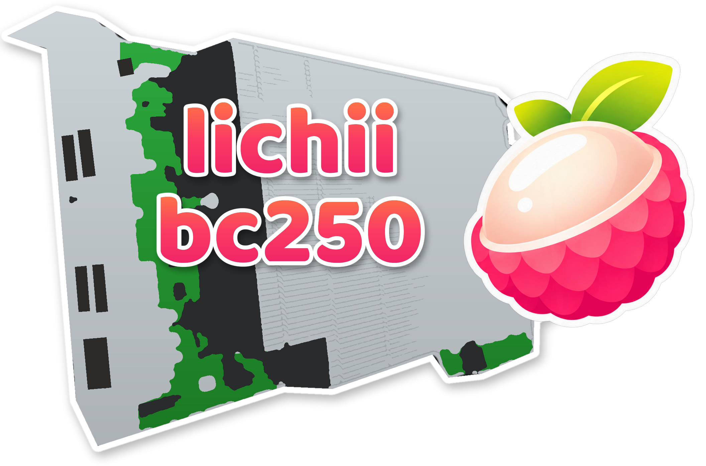

<p align="center">
  
</p>

# lichii-bc250 v7

> **Disclaimer: this project does not support or condone piracy.** No game data, keys,
> firmware or other copyrighted console assets are included, provided or linked here. The
> emulator requires you to dump **your own** game, keys and firmware from **your own**
> console; use it only with backups of content you legally own. Do not open issues about
> obtaining games, keys or firmware — they will be closed.

A [Lichii](https://github.com/zortos293/Lichii) fork optimized for the **AMD BC-250 console**
(GFX1013-class iGPU, RADV, 1080p TV output, 16 GB of memory shared by the CPU and the GPU). The
work targets the BC-250 itself (memory pressure, swap, GPU memory peaks, the container the
emulator runs in), so it helps whatever runs on it. **The Legend of Zelda: Ocarina of Time
(Switch 2)** is the title it has been tuned and measured on so far, so the numbers and the
installer's defaults are for it; other games are planned.

All emulator credit belongs to the Lichii, Eglantine, Eden and yuzu authors; this repo only
carries the BC-250-specific changes on top. GPLv3, like upstream. The repository was called
`oot-bc250` until 2026-11-11; GitHub redirects the old URL.

**What's new:** see [CHANGELOG.md](CHANGELOG.md). In short, v7 shortens the freezes when you enter
big areas, uses ~400 MB less GPU memory, and ships as a ready-made download: the installer no
longer has to compile anything (and there is an uninstaller).

## How it plays

Measured on the reference console (below), in play sessions through the Deku Tree and Hyrule
Field and in automated loops:

- **About 60 fps on screen.** The game runs at 28-30 fps; FSR3 frame generation adds one frame
  between each pair. When the game dips under 30 the TV shows a frame twice now and then, which
  reads as slight unevenness rather than stutter.
- **No more long hitches in play** (v6): the worst pause after loading went from 1-2.6 s to about
  0.15 s. New effects can appear a frame or two late the first time they show up in a session.
- **Loading an area** can still pause for about a second; the first visit to a big area (Castle Town)
  for 2-3 s.
- **The very first boot** of the game shows a black screen for 3-5 minutes (see step 5).

## Setup in five steps

You need a BC-250 running **CachyOS**, set up with the
[CachyOS BC250 Toolkit](https://github.com/redbeard1083/bc250-toolkit) (it provides the BC-250 kernel, GPU governor and
zswap swap setup this fork is run on), a controller, and your own game dump, keys and firmware.
Do everything on the BC-250 itself (Desktop Mode, or over ssh); commands with `sudo` ask for
your password. (The upstream fork targets Bazzite; the reference numbers below are from its
Bazzite console.) Each step ends with a **Check** so you know it worked.

### Step 1: prepare the BC-250 (once)

These system changes are what the measured performance assumes. They are outside the emulator
and survive its updates.

1. **Give the system more RAM: UMA carve-out 512 MB.** The BC-250 reserves part of its 16 GB
   for the GPU; the stock reservation leaves too little for the game. The setting lives in the
   board's CMOS (it survives OS reinstalls) and is written with
   [bc250_memcfg](https://github.com/fanoush/bc250_memcfg) (build it from source as its README
   says):

   ```sh
   sudo bc250memcfg UMA_SIZE 512
   sudo systemctl reboot
   ```

   **Check:** `free -m` shows about 15 GB of total memory, and
   `cat /sys/class/drm/card*/device/mem_info_vram_total` shows `536870912`.

2. **Stop the system from swapping the game out early: swappiness 10.** A high swappiness
   pushes the game's memory to swap while RAM is still free and causes multi-second freezes.
   The BC250 Toolkit writes its own `/etc/sysctl.d/99-swappiness.conf` (60), which sorts after
   a `99-bc250-*` file and wins, so set the value in the toolkit's file:

   ```sh
   sudo sed -i 's/^vm.swappiness = .*/vm.swappiness = 10/' /etc/sysctl.d/99-swappiness.conf
   sudo sysctl --system
   ```

   **Check:** `cat /proc/sys/vm/swappiness` shows `10`, also after a reboot.

3. **Keep memory defragmented: compaction proactiveness 100.** The GPU driver asks for memory in
   2 MB blocks; when memory is fragmented the kernel frees space by swapping the game out, even
   with gigabytes of RAM free, and the game stalls when it needs that memory back. Background
   compaction prepares those blocks instead (in a Deku Tree session it cut the 10-second windows
   with drops from 69% to 43%):

   ```sh
   printf 'vm.compaction_proactiveness = 100\n' > /tmp/compaction.conf
   sudo install -m 644 /tmp/compaction.conf /etc/sysctl.d/99-bc250-compaction.conf
   sudo sysctl --system
   ```

   **Check:** `cat /proc/sys/vm/compaction_proactiveness` shows `100`, also after a reboot.

4. **Keep 1.5 GB of RAM free ahead of time: watermark scale factor 1000.** A big area load needs
   gigabytes of GPU memory at once (Ocarina's Castle Town: about 3 GB in 30 s). With the kernel's
   default (125) it keeps only ~190 MB free, so every one of those allocations waits while the
   kernel compresses other memory into swap: a 10-14 s freeze on the first visit. With 1000 the
   kernel's background thread keeps ~1.5 GB free, and the same entry freezes for 2-3 s:

   ```sh
   printf 'vm.watermark_scale_factor = 1000\n' > /tmp/watermark.conf
   sudo install -m 644 /tmp/watermark.conf /etc/sysctl.d/99-bc250-watermark.conf
   sudo sysctl --system
   ```

   **Check:** `cat /proc/sys/vm/watermark_scale_factor` shows `1000`, also after a reboot.

5. **Compressed swap in RAM with zstd, plus a disk swapfile.** The BC250 Toolkit sets up zswap
   (a compressed cache in RAM in front of a 16 GB swapfile) but chooses `lz4`, which only fits
   ~1.75:1; `zstd` fits ~2-3:1, so more of the swapped game stays in RAM instead of being read
   back from disk (reading it back from disk froze the game for up to 27 s in long Castle Town
   sessions). The CachyOS kernel has zstd built in; switch it now and on the kernel command
   line (Limine; `limine-update` also re-enrolls the boot config's checksum):

   ```sh
   echo zstd | sudo tee /sys/module/zswap/parameters/compressor
   sudo sed -i 's/zswap.compressor=lz4/zswap.compressor=zstd/' /etc/default/limine
   sudo limine-update
   ```

   **Check:** `cat /sys/module/zswap/parameters/compressor` shows `zstd`, and `swapon --show`
   lists the swapfile.

6. **Optional: a larger GPU memory limit.** The game's GPU memory peaks around 5 GB during an
   area load, under the kernel's default limit (half of RAM) but not by much:

   ```sh
   # add ttm.pages_limit=3145728 ttm.page_pool_size=3145728 to KERNEL_CMDLINE in
   # /etc/default/limine (the BC250 Toolkit may already set pages_limit), then:
   sudo limine-update
   sudo systemctl reboot
   ```

   **Check:** `cat /proc/cmdline` contains `ttm.pages_limit=3145728`.

7. **Optional: all 8 CPU cores, 40 GPU compute units, GPU clock 500-2000 MHz.** The reference
   console uses these (set with the BC-250 community tools and the image's
   `cyan-skillfish-governor-smu` config). They help a little; the steps above matter more.
   2000 MHz is above the image's default of 1850: watch your temperatures.

   With the 8-core unlock and the toolkit's BC-250 kernel, also apply the toolkit's **Patch SMU
   Metrics** for your BIOS (CPU Cores Unlock menu). Without it the kernel reads the SMU's
   telemetry at the wrong offsets: GPU temperature 0, clocks and power garbage, and the GPU
   governor's thermal throttle never triggers.

   **Check:** `nproc` shows `16` with all 8 cores, and the GPU temperature
   (`/sys/class/drm/card*/device/hwmon/hwmon*/temp1_input`) is not `0`.

8. **If you use the toolkit's Mesa build:** it advertises `VK_EXT_mesh_shader` on the BC-250,
   which has no mesh hardware; native task/mesh draws then render white. The installer's
   launcher sets `EDEN_NX2_FORCE_MESH_FALLBACK=1`, which keeps the emulator's own fallback.

9. **Bluetooth Xbox One S-style pads (including 8BitDo adapters in X-input mode):** Steam's
   udev rules leave out their hidraw node (045E:02E0), so under Steam Input the buttons work but
   the sticks don't. The installer adds a rule for it.

### Step 2: put your keys and firmware in place

Dump them from your own console, then copy them where the emulator expects them:

- keys: `~/.local/share/eden/keys/` (`prod.keys`, `title.keys`);
- firmware: `~/.local/share/eden/nand/system/Contents/registered/`.

**Check:** both folders exist and are not empty.

### Step 3: install

Download the prebuilt release (no compiling, a few minutes):

```sh
git clone https://github.com/bwnance/lichii-bc250.git
cd lichii-bc250
./tools/bc250/bc250-install.sh
```

It downloads the latest release package from GitHub (built with Lichii's performance profile on
Ubuntu 24.04; it runs on CachyOS and Bazzite and uses the system's own GPU driver), unpacks it
to `~/Applications/lichii-bc250/lichii`, and installs the launcher
`~/Applications/lichii-bc250/lichii-bc250`, which sets the BC-250 tuning, plus the game settings
`~/Applications/lichii-bc250/oot.ini` (frame generation, the presentation queue, the Xbox 360
controller mapping, and so on). `--release v7` picks a specific release.

**Build it yourself instead** (30-60 minutes the first time):

```sh
./tools/bc250/bc250-install.sh --build --pgo
```

This installs the build tools with pacman (asks for sudo once) and builds `eden-cli` on the
system itself with Lichii's performance profile, about 10% faster. CachyOS's own LLVM (clang 22
or newer) reads the profile; with an older clang the installer downloads LLVM 23 once (~2 GB,
~600 MB kept in `~/.local/share/lichii-bc250/llvm23`). Leave `--pgo` out to build with the
system's clang and no profile.

Either way the installer also adds the controller udev rule from step 1.

**Check:** the installer ends with `Installed.` and the launch command.

### Step 4: add the game to Steam (optional)

To start the game from Gaming Mode with a controller, register it as a non-Steam game. Steam
must be closed for this (it rewrites its shortcut file otherwise): switch to Desktop Mode, quit
Steam, then run:

```sh
./tools/bc250/bc250-install.sh --with-shortcut --game "/path/to/your/Ocarina of Time dump"
```

The second run downloads the package again (or reuses your build with `--build`) and adds the shortcut. Start Steam again: the game
is in your library under **Non-Steam**.

Without Steam, launch it directly:

```sh
~/Applications/lichii-bc250/lichii-bc250 -f -c ~/Applications/lichii-bc250/oot.ini \
  -g "/path/to/your/Ocarina of Time dump"
```

**Check:** the game starts (see step 5 for the first boot).

### Step 5: the first launch

- **Connect the controller before you start the game** (an Xbox 360 wireless receiver is the
  tested setup). It also reconnects if it drops out mid-game.
- **The first boot stays black for 3-5 minutes** while the shader pipelines are prepared. This
  is normal and happens once per game version and emulator build; later boots are much faster.
  New areas hitch a little the first time you visit them, for the same reason.
- **The first minute in each area is rougher** than the rest (see "How it plays").

## Updating

```sh
cd lichii-bc250
git pull
./tools/bc250/bc250-install.sh            # or: --build --pgo if you build it yourself
```

Your `oot.ini` is kept (controls and your own changes), but the installer brings its frame
generation settings up to date. A Steam shortcut made earlier keeps working.

## Uninstalling

```sh
./tools/bc250/bc250-uninstall.sh            # launcher, package, Steam shortcut, build container
./tools/bc250/bc250-uninstall.sh --system   # also reverts the sysctl and zram steps (sudo)
```

Close Steam first if you want the shortcut removed (Steam rewrites its shortcut file otherwise).
Your saves, keys, firmware and shader caches in `~/.local/share/eden` are never touched; the disk
swapfile and kernel arguments are left in place, and the uninstaller prints how to remove them.

## Settings worth knowing

All of these are in `oot.ini`; every value needs its `<key>\default=false` line next to it, or
the emulator ignores it.

- **Frame generation** (`frame_gen=true`, FSR3, multiplier 2, `frame_gen_target_rate=0`): one
  generated frame between every two game frames, ~60 fps on screen from a ~30 fps game.
  Don't set the target rate to 60: the emulator then generates two frames per game frame and
  the game slows to 20 fps.
- **Presentation queue** (`frame_gen_queue_target=1`): four frames waiting for the TV instead of
  three, which smooths delivery. `0` goes back to three.
- **Max Resolution add-on** (on): renders the scene at full 1080p. Without it the image is
  smaller and upscaled, which looks soft on a TV; it costs no measurable fps here.
- **Dynamic FPS add-on** (on): keeps the game at normal speed when the frame rate dips. Without
  it the game runs in slow motion below 30 fps.
- **Controllers:** the template carries the Xbox 360 receiver mapping. A different pad needs its
  own `player_0_*` lines in `[Controls]` (or configure it once in a GUI build and copy the
  block over).
- **Shader cache:** `~/.cache/eden/shader/0400486024dec000/` for Ocarina of Time. A cache from
  an earlier run shortens the first boot; it does not change frame rates.

## Reference console

The numbers above were measured on this setup (step 1 with all the optional items):

| Setting | Value |
|---|---|
| OS | Bazzite (62fixolab BC-250 image), Gaming Mode at 1920x1080 |
| Memory | 16 GB total, UMA carve-out 512 MB (~15.2 GB system RAM) |
| Swap | zram (zstd, 3/4 of RAM) plus a 16 GB disk swapfile, `vm.swappiness=10`, `vm.compaction_proactiveness=100`, `vm.watermark_scale_factor=1000` |
| CPU | 8 cores / 16 threads (stock boots with 6 cores) |
| GPU | 40 compute units, governor 500-2000 MHz |
| GPU memory limit | `ttm.pages_limit=3145728` (12 GB) |

Things that made no difference on this board, so you can skip them: a lower internal
resolution or a smaller texture cache budget, pinning the GPU clock to maximum, `lz4` instead of
`zstd` for zram (worse: it compresses less), the Fritchii v5 builds (tuned for desktop GPUs,
slower here), and Mailbox or FIFO-relaxed present modes.

## What this fork changes

<details>
<summary>Technical summary (details per version in CHANGELOG.md)</summary>

1. **AMD performance fixes from Lichii PR #573, extended to RADV.** Upstream only enabled them
   for AMD's Windows driver; the BC-250 runs Mesa's RADV:
   - query-cache copies no longer block on slots where no query ended (removes Ocarina's
     occlusion-culling stalls); since build 150 this is upstream's wait-on-last copy (#679),
     extended to RADV, plus a non-blocking host read of query results;
   - already-satisfied semaphore acquires skip the split GPU thread's drain;
   - native submission budget of 512 draws on RADV;
   - large texture unswizzles split over helper threads;
   - the Kokiri Forest compute shader builds unoptimized (1.3-4 s stalls on AMD otherwise);
   - async draw discard defaults on for RADV (new pipelines no longer freeze the game).
2. **Task/mesh shader fallback** (upstream PR #569) with a narrower barrier, empty-draw skip and
   smaller arenas: the BC-250's GPU has no `VK_EXT_mesh_shader`, so without it Ocarina's foliage
   and building walls are missing.
3. **Memory work for a 16 GB shared-memory board:** staging buffers in 8 MiB steps, ASTC
   textures re-compressed a few layers at a time, a texture cache that keeps recently used
   textures, capped compute bindings, smaller mesh arenas, `MADV_COLD` instead of
   `MADV_PAGEOUT`.
4. **Frame pacing:** the game runs two frames ahead of the GPU threads, GPU threads pinned to
   their own cores, frame generation always 2x with a four-frame presentation queue.
5. **Containers:** controllers reconnect inside the distrobox (SDL uses inotify instead of
   udev there).
6. **Diagnostics** (all off unless their variable is set): stutter trace, GPU thread profile, a
   Chrome-trace timeline of the GPU threads (`EDEN_NX2_TIMELINE`), on-screen repeat counts in the
   log, GPU memory peak dumps, command-list round-trip timing.

</details>

## Building by hand

The installer is the supported path. To build without it (tested on CachyOS with clang;
`src/audio_core/out/` must be present):

```sh
cmake -S . -B build -G Ninja -DCMAKE_BUILD_TYPE=Release \
  -DENABLE_QT=OFF -DYUZU_CMD=ON -DENABLE_WEB_SERVICE=OFF -DYUZU_ROOM=OFF \
  -DYUZU_TESTS=OFF -DBUILD_TESTING=OFF -DENABLE_WERROR=OFF -DENABLE_UPDATE_CHECKER=OFF \
  -DCMAKE_C_COMPILER=clang -DCMAKE_CXX_COMPILER=clang++
cmake --build build --target eden-cli --parallel 4
```

For the PGO build by hand, see "Building with PGO" in [CHANGELOG.md](CHANGELOG.md#building-with-pgo).

**Base:** Lichii `nx2` build 150 (`17baed716d`) plus selected build 160 commits and this fork's
changes. Data stays in the Eden folders (`~/.local/share/eden`, `~/.config/eden`,
`~/.cache/eden`).
